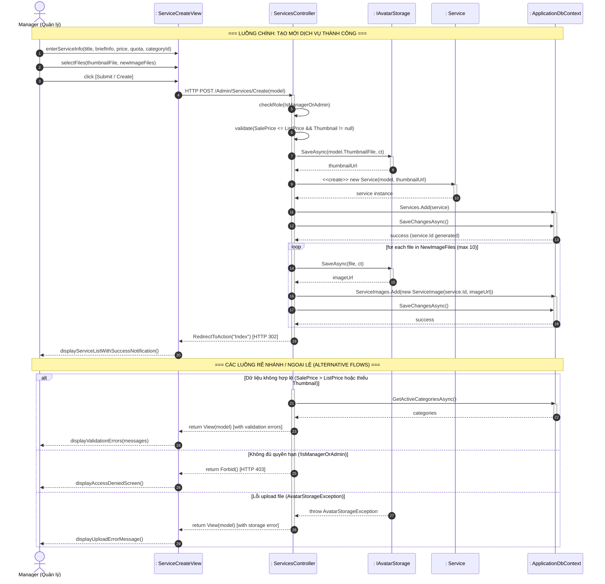
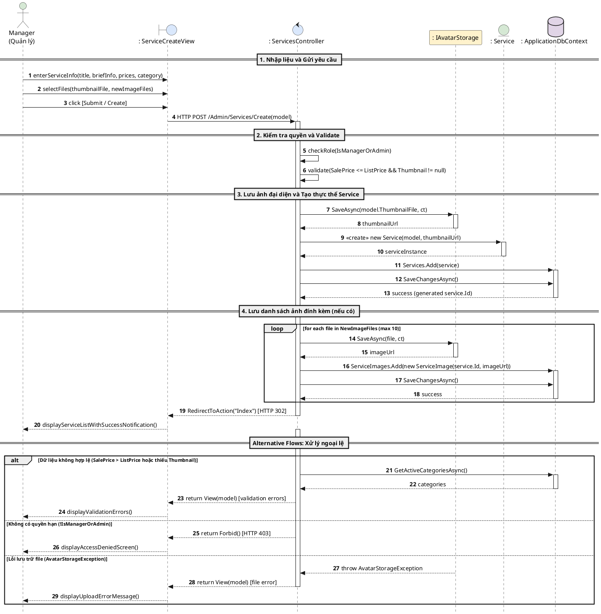

# Thuyết Minh & Thiết Kế Sơ Đồ Tuần Tự (Sequence Diagram) – Luồng 3: Dịch Vụ (Services)

Tài liệu này được xây dựng dựa trên mã nguồn đã hoàn thiện và tài liệu đặc tả của **Hệ thống Children Care**, phục vụ việc hiện thực hóa mô hình phân tích và thiết kế theo chuẩn UML cho **Luồng 3: Quản lý Dịch vụ (Service Management)**.

Tệp sơ đồ tương ứng trên Draw.io: [`SequenceDiagram_Part3_Services.drawio`](file:///d:/WorkSpace/CRUD_ChildrenCare/docs/SequenceDiagram_Part3_Services.drawio)

---

## 1. Phát Triển Mô Hình Use Case (Develop UC Model)

Use Case được lựa chọn làm đại diện tiêu biểu và đầy đủ nhất của Luồng 3 là **Thêm Mới Dịch Vụ (Create New Service)**.

| Mục | Nội Dung Đặc Tả |
| :--- | :--- |
| **Tên Use Case (UC Name)** | **Thêm Mới Dịch Vụ (Create New Service)** |
| **Mã Use Case (UC ID)** | UC-SRV-01 |
| **Tác Nhân (Primary Actor)** | **Manager** (hoặc **Admin**) |
| **Mục Tiêu (Goal)** | Cho phép Quản lý tạo mới một gói dịch vụ khám/chăm sóc trẻ em vào hệ thống, bao gồm thông tin chi tiết, giá tiền, ảnh đại diện và bộ sưu tập ảnh đính kèm. |
| **Tiền Điều Kiện (Pre-conditions)** | 1. Người dùng đã đăng nhập hệ thống với vai trò `Manager` hoặc `Admin`. 2. Các danh mục dịch vụ (`ServiceCategory`) đã được kích hoạt trong bảng cấu hình `Setting`. |
| **Hậu Điều Kiện (Post-conditions)** | 1. Bản ghi `Service` mới được lưu vào CSDL với trạng thái thiết lập. 2. Các file ảnh (thumbnail và gallery) được lưu trữ vào thư mục lưu trữ (`wwwroot/uploads`). 3. Các bản ghi `ServiceImage` liên kết được khởi tạo. 4. Quản lý được chuyển hướng về trang danh sách dịch vụ và thấy dịch vụ mới tạo. |

### Mô Tả Chuỗi Thao Tác Chính (Main Sequence of Events)
1. **Manager** mở trang biểu mẫu tạo mới dịch vụ.
2. Hệ thống tải danh sách danh mục dịch vụ đang kích hoạt (`ServiceCategory`) và hiển thị biểu mẫu `ServiceCreateView`.
3. **Manager** nhập các thông tin dịch vụ (`Title`, `BriefInfo`, `Description`, `NumberOfPerson`, `ListPrice`, `SalePrice`, `AvailableQuantity`, `IsFeatured`, `Status`, `CategoryId`).
4. **Manager** chọn file ảnh đại diện (`ThumbnailFile`) và các file ảnh đính kèm (`NewImageFiles`).
5. **Manager** nhấn nút **[Create / Submit]**.
6. Giao diện gửi yêu cầu HTTP POST đến `ServicesController.Create(model)`.
7. `ServicesController` kiểm tra quyền hạn (`IsManagerOrAdmin`) và xác thực tính hợp lệ của dữ liệu (Model validation: `SalePrice <= ListPrice`, `Thumbnail` bắt buộc).
8. `ServicesController` gọi dịch vụ lưu trữ `IAvatarStorage.SaveAsync` để lưu file ảnh đại diện và nhận lại URL ảnh.
9. `ServicesController` tạo mới đối tượng thực thể `Service` từ dữ liệu form và URL ảnh.
10. `ServicesController` thêm đối tượng `Service` vào `ApplicationDbContext.Services` và gọi `SaveChangesAsync()` để lưu vào CSDL, nhận `Service.Id` vừa sinh.
11. Với mỗi file ảnh phụ hợp lệ trong `NewImageFiles`, `ServicesController` gọi `IAvatarStorage.SaveAsync` lưu file và tạo các đối tượng `ServiceImage` liên kết với `Service.Id`.
12. `ServicesController` lưu các bản ghi `ServiceImage` vào CSDL qua `ApplicationDbContext.SaveChangesAsync()`.
13. `ServicesController` trả về lệnh chuyển hướng `RedirectToAction("Index")`.
14. Giao diện hiển thị trang danh sách dịch vụ kèm thông báo thêm mới thành công.

---

## 2. Xác Định Các Đối Tượng Thực Hiện Use Case (Determine Objects Needed)

### 2a. Đối Tượng Biên (Boundary Objects)
* **`ServiceCreateView`** (Giao diện Web / Razor View `Areas/Admin/Views/Services/Create.cshtml`):
  * Chịu trách nhiệm hiển thị form nhập liệu cho Manager.
  * Tiếp nhận tương tác người dùng (nhập chữ, chọn dropdown danh mục, chọn upload file).
  * Đóng gói dữ liệu thành `ServiceFormViewModel` và gửi HTTP POST request đến server.
  * Hiển thị thông báo lỗi validate hoặc thông báo thành công cho người dùng.

### 2b. Đối Tượng Phần Mềm Nội Bộ (Internal Software Objects)
* **Đối Tượng Điều Khiển (Controller / Control Object)**:
  * **`ServicesController`** (`CRUD_ChildrenCare.Controllers.Admin.ServicesController`):
    * Điều phối toàn bộ luồng nghiệp vụ tạo mới dịch vụ.
    * Kiểm tra vai trò người dùng (`[Authorize]`, `IsManagerOrAdmin`).
    * Thực hiện validation nghiệp vụ (`ModelState`, so sánh `SalePrice <= ListPrice`).
    * Điều phối việc lưu trữ file và tương tác với cơ sở dữ liệu.
* **Đối Tượng Dịch Vụ / Tiện Ích Hỗ Trợ (Service / Storage Object)**:
  * **`IAvatarStorage`** (`CRUD_ChildrenCare.Services.Files.IAvatarStorage`):
    * Thực hiện đọc stream dữ liệu của các file ảnh được tải lên (`IFormFile`).
    * Kiểm tra phần mở rộng file (jpg, jpeg, png, gif, webp).
    * Ghi file vật lý vào máy chủ/thư mục lưu trữ và trả về đường dẫn URL an toàn.
* **Đối Tượng Thực Thể Miền (Domain / Entity Objects)**:
  * **`Service`** (`CRUD_ChildrenCare.Models.Service`): Đại diện cho bản ghi dịch vụ với các thuộc tính khóa chính, tiêu đề, giá niêm yết, giá khuyến mãi, trạng thái...
  * **`ServiceImage`** (`CRUD_ChildrenCare.Models.ServiceImage`): Đại diện cho các ảnh đính kèm liên kết với `Service` qua khóa ngoại `ServiceId`.
* **Đối Tượng Truy Cập Dữ Liệu (Data Access / DbContext Object)**:
  * **`ApplicationDbContext`** (`CRUD_ChildrenCare.Data.ApplicationDbContext`):
    * Cung cấp các `DbSet<Service>`, `DbSet<ServiceImage>`, `DbSet<Setting>`.
    * Thực thi các truy vấn LINQ và ánh xạ lưu dữ liệu xuống hệ quản trị CSDL SQL Server qua Entity Framework Core (`SaveChangesAsync`).

---

## 3. Xác Định Trình Tự Giao Tiếp Thông Điệp (Determine Message Communication Sequence - Main Flow)

Dưới đây là bảng thông điệp tuần tự của luồng chính:

| STT | Đối Tượng Gửi | Đối Tượng Nhận | Thông Điệp / Lời Gọi Hàm | Ý Nghĩa / Dữ Liệu |
| :---: | :--- | :--- | :--- | :--- |
| **1** | `Manager` | `: ServiceCreateView` | `enterServiceInfo(title, briefInfo, price, quota, categoryId)` | Người dùng nhập các thông tin của dịch vụ vào form |
| **2** | `Manager` | `: ServiceCreateView` | `selectFiles(thumbnailFile, newImageFiles)` | Chọn file ảnh đại diện và các ảnh chi tiết |
| **3** | `Manager` | `: ServiceCreateView` | `click [Submit / Create]` | Bấm nút gửi form |
| **4** | `: ServiceCreateView` | `: ServicesController` | `HTTP POST /Admin/Services/Create(model)` | Gửi dữ liệu form `ServiceFormViewModel` |
| **5** | `: ServicesController` | `: ServicesController` | `checkRole(IsManagerOrAdmin)` | Kiểm tra quyền truy cập (Manager/Admin) |
| **6** | `: ServicesController` | `: ServicesController` | `validate(SalePrice <= ListPrice && Thumbnail != null)` | Kiểm tra tính hợp lệ dữ liệu và ràng buộc giá |
| **7** | `: ServicesController` | `: IAvatarStorage` | `SaveAsync(model.ThumbnailFile, ct)` | Gửi file thumbnail để lưu trữ vật lý |
| **8** | `: IAvatarStorage` | `: ServicesController` | `thumbnailUrl` | Trả về đường dẫn URL của thumbnail |
| **9** | `: ServicesController` | `: Service` | `<<create>> new Service(model, thumbnailUrl)` | Khởi tạo đối tượng thực thể `Service` mới |
| **10** | `: Service` | `: ServicesController` | `service` | Trả về instance thực thể `Service` |
| **11** | `: ServicesController` | `: ApplicationDbContext` | `Services.Add(service)` | Đưa entity vào tập theo dõi của DbContext |
| **12** | `: ServicesController` | `: ApplicationDbContext` | `SaveChangesAsync()` | Ghi xuống CSDL SQL Server |
| **13** | `: ApplicationDbContext` | `: ServicesController` | `success (generated service.Id)` | CSDL sinh khóa chính tự tăng `service.Id` |
| **14** | `: ServicesController` | `: IAvatarStorage` | `SaveAsync(file, ct)` | *[Lặp cho từng ảnh]* Lưu file ảnh chi tiết |
| **15** | `: IAvatarStorage` | `: ServicesController` | `imageUrl` | Trả về URL của ảnh chi tiết |
| **16** | `: ServicesController` | `: ApplicationDbContext` | `ServiceImages.Add(new ServiceImage(...))` | Thêm thực thể `ServiceImage` vào DbContext |
| **17** | `: ServicesController` | `: ApplicationDbContext` | `SaveChangesAsync()` | Lưu tất cả các ảnh chi tiết vào CSDL |
| **18** | `: ApplicationDbContext` | `: ServicesController` | `success` | Xác nhận lưu thành công |
| **19** | `: ServicesController` | `: ServiceCreateView` | `RedirectToAction(Index) [HTTP 302]` | Chuyển hướng sang màn hình danh sách |
| **20** | `: ServiceCreateView` | `Manager` | `displayServiceListWithSuccessNotification()` | Hiển thị danh sách dịch vụ cập nhật cho Manager |

---

## 4. Xác Định Các Chuỗi Rẽ Nhánh / Ngoại Lệ (Determine Alternative Sequences)

Hệ thống xử lý 3 luồng ngoại lệ/rẽ nhánh chính:

### 4.1. Ngoại Lệ Dữ Liệu Không Hợp Lệ (`ModelState.IsValid == false`)
* **Điều kiện**: `SalePrice > ListPrice` hoặc không chọn file ảnh đại diện và trường `Thumbnail` rỗng.
* **Chuỗi thông điệp**:
  1. `ServicesController` gọi `ModelState.AddModelError(...)` với thông báo lỗi thích hợp.
  2. `ServicesController` gọi `dbContext.GetActiveCategoriesAsync()` để nạp lại danh sách danh mục.
  3. `ServicesController` trả về `View(model)` kèm các lỗi xác thực.
  4. `ServiceCreateView` hiển thị lại form với các thông báo lỗi màu đỏ tại từng ô nhập liệu.

### 4.2. Ngoại Lệ Không Đủ Quyền Hạn (`!IsManagerOrAdmin`)
* **Điều kiện**: Tài khoản đang thao tác có vai trò không phải Manager hoặc Admin (ví dụ Doctor, Nurse hoặc Customer cố gắng gửi POST request tạo dịch vụ).
* **Chuỗi thông điệp**:
  1. `ServicesController` phát hiện `!IsManagerOrAdmin`.
  2. `ServicesController` trả về `Forbid()` (Mã trạng thái HTTP 403 Forbidden).
  3. `ServiceCreateView` chuyển hướng và hiển thị trang thông báo từ chối truy cập (Access Denied).

### 4.3. Ngoại Lệ Lỗi Lưu Trữ Tệp Tin (`AvatarStorageException`)
* **Điều kiện**: File upload không đúng định dạng cho phép (không phải file ảnh) hoặc quá dung lượng quy định.
* **Chuỗi thông điệp**:
  1. `IAvatarStorage.SaveAsync(...)` ném ngoại lệ `AvatarStorageException(message)`.
  2. `ServicesController` bắt ngoại lệ qua khối `try-catch` và gán thông báo lỗi vào `ModelState`.
  3. `ServicesController` trả về `View(model)` cho người dùng.
  4. `ServiceCreateView` hiển thị thông báo lỗi upload file để người dùng chọn lại tệp hợp lệ.

---

## 5. Sơ Đồ Tuần Tự Bằng Mermaid (Mermaid Sequence Diagram)

---

## 6. Mã PlantUML Chuẩn Hóa Báo Cáo Đồ Án

---

## 7. Liên Kết Tệp Vẽ Draw.io

Tệp thiết kế đồ họa hoàn chỉnh với đầy đủ các đối tượng Lifeline, Activation Bars, Synchronous Messages, Return Dashed Messages, Loop Box và Alt Fragments đã được tạo trực tiếp tại:
* [`docs/SequenceDiagram_Part3_Services.drawio`](file:///d:/WorkSpace/CRUD_ChildrenCare/docs/SequenceDiagram_Part3_Services.drawio)

Người dùng có thể mở tệp này bằng ứng dụng **Draw.io Desktop**, extension **Draw.io Integration trong VS Code / IDE**, hoặc mở trực tiếp trên trình duyệt qua website [app.diagrams.net](https://app.diagrams.net).
