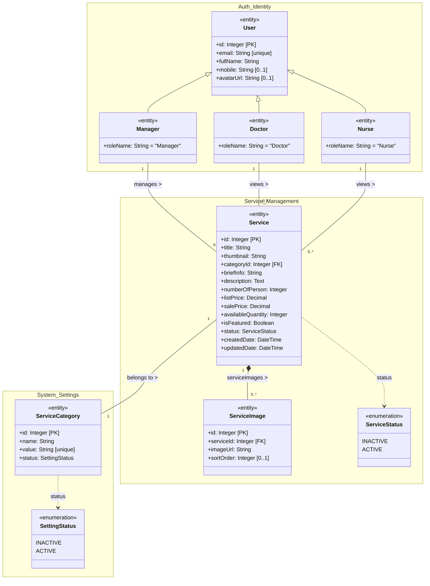
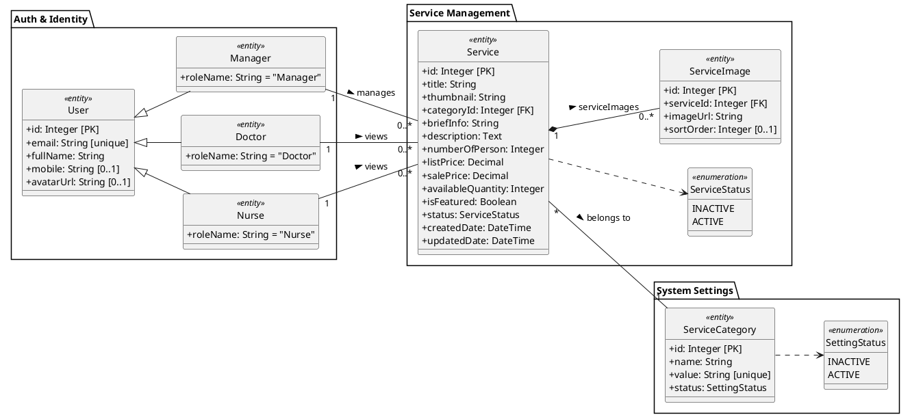
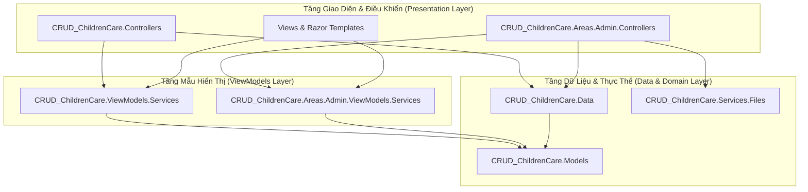
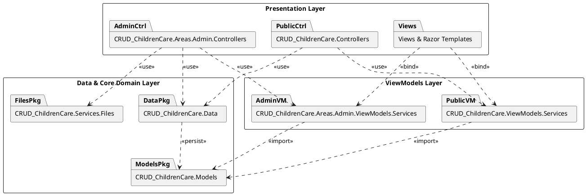

# Thuyết Minh Sơ Đồ Lớp (Class Diagram) & Sơ Đồ Gói (Package Diagram) – Phần 3: Dịch Vụ (Services)

Tài liệu này thuyết minh kiến trúc phần mềm chuẩn UML, cấu trúc lớp và phân chia gói (package structure) dành riêng cho **Phần 3: Dịch Vụ (Service Module)** của hệ thống **Children Care**, chuẩn hóa theo phong cách mẫu Class Diagram quy chuẩn đồ án.

---

## 1. Sơ Đồ Lớp (Class Diagram)

### 1.1. Sơ đồ bằng Mermaid

### 1.2. Mã PlantUML Chuẩn Hóa Theo Mẫu Đồ Án

---

## 2. Sơ Đồ Gói (Package Diagram)

### 2.1. Sơ đồ bằng Mermaid

### 2.2. Mã PlantUML cho Package Diagram

